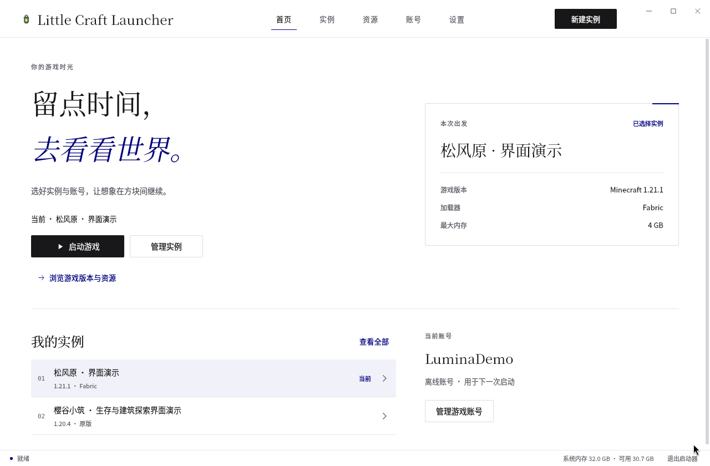
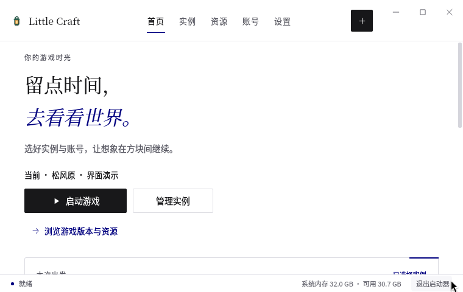

# Little Craft Launcher

**Your worlds, your mods, your next adventure — kept in order.**

A native Minecraft Java Edition launcher for Windows, with separate instances for each way you play.

**English** · [简体中文](README.zh-CN.md)

[Downloads and release notes](https://github.com/TaoXiaoBai/little-craft-launcher-releases/releases) · [Accounts and data](#accounts-and-data) · [Report an issue](https://github.com/TaoXiaoBai/little-craft-launcher-releases/issues)

Windows 10/11 x64 · Eleven themes · Qt Quick

> **1.0.0 is in preparation. No official installation package has been published in this repository yet.** This page introduces the development version. The interface is still being upgraded; supported features and installation instructions will be recorded with each release.

## Make room for every playthrough

| What you need | What the launcher provides |
| --- | --- |
| Separate setups | Create, copy and import instances with their own game version, Java, memory and launch settings. Export modpacks when you need to share a setup. |
| Compatible content | Browse mods, resource packs and modpacks; review dependencies, changes and the target instance before installing. |
| Favorite mods, reused | Save Modrinth projects and find compatible versions for another instance, rather than copying old JARs. |
| Worlds you can return to | Back up and export worlds, then preview an import or restore before applying it. |
| Useful feedback | Inspect tasks and logs, export diagnostics and review memory risks before launching. A memory advisory is not a game-compatibility or FPS verdict. |
| A familiar workspace | Eleven themes share the same pages and controls, with alternative navigation layouts and a reduced-motion setting. |

**Loader scope:** Vanilla, Fabric and Quilt have installation paths. The native Forge installer currently targets Minecraft **1.20.1**, and NeoForge **1.21.1**. Check the available combinations in the app; other versions are not implied to work.

**Modpacks:** Modrinth packs can be previewed and installed into new instances. CurseForge uses an authorized API key for the current session; its catalog does not currently create new modpack instances directly. Local pack import is available.

## Choose your surroundings

Forest Light, Classic Dark, Graphite, Ore, Sand, Windows 11, Material 3, WinUI × MD3, Material 3 Expressive, **Koring Glass (`Koring · 轻玻璃`)** and **Lumina (`留白 · Lumina`)** use the same Qt Quick application. The lantern keeps its original colors across themes.

Choose a theme under **Settings → Appearance**. Koring Glass provides a top navigation capsule and page-specific sidebars. Lumina combines white space, serif headings and horizontal navigation; its Home pairs the current instance and launch action with a useful summary, then stacks into a scrollable layout in smaller windows.

View the compact-window preview

These are real Qt development windows using synthetic demonstration data, captured on Linux with software rendering. The previews use Simplified Chinese. They are not Windows acceptance evidence or screenshots of a released build. [Image provenance and design reference](assets/README.md).

## Start playing after release

1. **Get a released build.** Use [Releases](https://github.com/TaoXiaoBai/little-craft-launcher-releases/releases), read its notes and verify the SHA-256. Follow that version's instructions for installing or extracting the complete package.
2. **Set up your account and Java.** Review the data location and select or detect a compatible Java runtime. Microsoft sign-in availability depends on the project's registration and service-access configuration described below.
3. **Create or import an instance.** Choose a game version and loader, prepare the game files, then launch from Home. Back up worlds before changing versions or modpacks.

The launcher does not bundle Minecraft, Java or account credentials. Release notes will identify the package format, requirements and version-matched supporting materials.

## Accounts and data

### Microsoft sign-in

The Microsoft sign-in implementation opens the system browser and uses the OAuth authorization-code flow with S256 PKCE and a local loopback callback. It then uses official Microsoft, Xbox and Minecraft services to validate the session, Minecraft Java Edition ownership and player profile. It does not ask users to enter their Microsoft password into the launcher's own interface. Microsoft login credentials saved on Windows are protected with DPAPI, without a plaintext fallback.

**Current status:** this project's own public-client configuration and relevant service access are still being prepared. Real-account Microsoft sign-in has not completed release acceptance. Application registration, service access and individual user consent are separate requirements; sign-in configuration must use a public Client ID owned by or explicitly authorized for this project.

### Account availability

Only a fresh, valid mainland China (`CN`) region detection permits explicitly trusted external authentication or limited local identities. Other regions, including `HK`, `MO` and `TW`, and unknown or expired detection require Microsoft authentication and Minecraft ownership verification. Missing Microsoft configuration blocks that sign-in flow.

LittleSkin is an address suggestion, not automatic trust. External authentication sends that service's credentials only after the user explicitly trusts the selected service. **Do not enter a Microsoft password into an external-authentication form.** External or local identities do not establish Minecraft ownership or grant access to official online services.

### Local data

New installations use per-user local application data. An existing `mclauncher-qt-data` beside the EXE remains in use; `--portable` explicitly selects that directory, and `--data-root` takes precedence with an absolute path. Data does not migrate automatically. Close the game and launcher before backing up or moving the entire directory.

## Feedback and project information

Maintained by [TaoXiaoBai](https://github.com/TaoXiaoBai). This repository is the public home for project information, releases and [issue reports](https://github.com/TaoXiaoBai/little-craft-launcher-releases/issues).

When reporting a problem, include the launcher version, Windows version, reproduction steps, expected and actual behavior, and only the relevant redacted logs. Review logs before sharing them. Keep passwords, access tokens, account databases and private worlds out of public reports.

## Source and licensing

The application source is currently private. Opening the source will be evaluated after the launcher stabilizes; no date has been set. This public repository does not grant a general open-source or unrestricted application-redistribution license.

Third-party components and artwork retain their own licenses. Applicable notices, license texts and version-matched source or relinking materials will be provided with each release through the links in its release notes. Keeping application development private does not remove those obligations.

This project is an independent third-party launcher, not an official Mojang or Microsoft product, and is not affiliated with external authentication providers.
