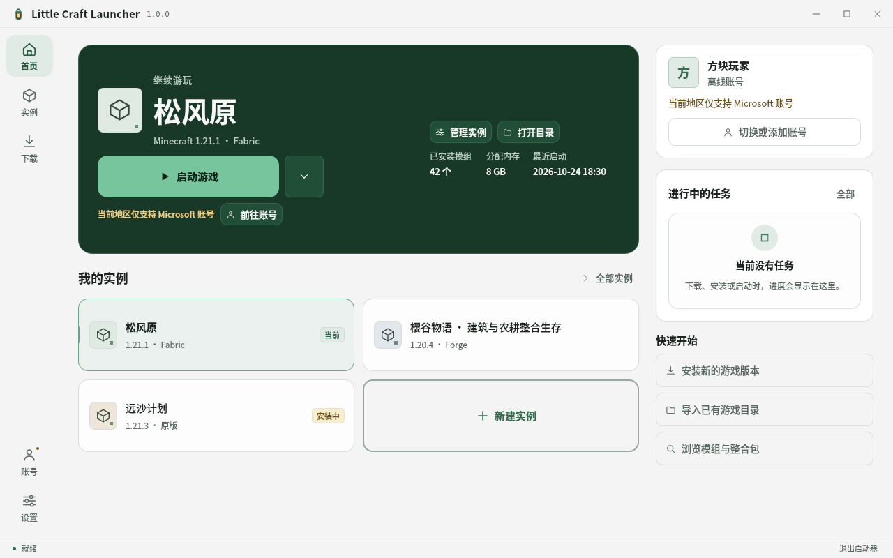
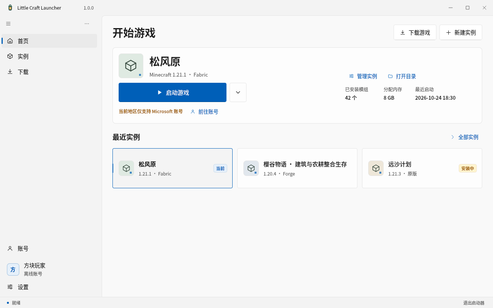
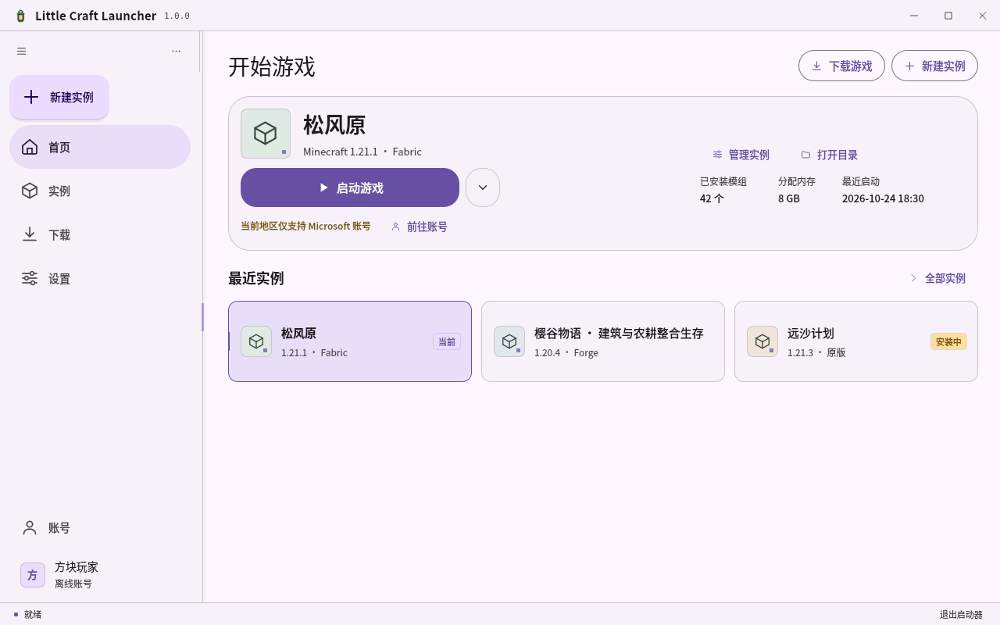
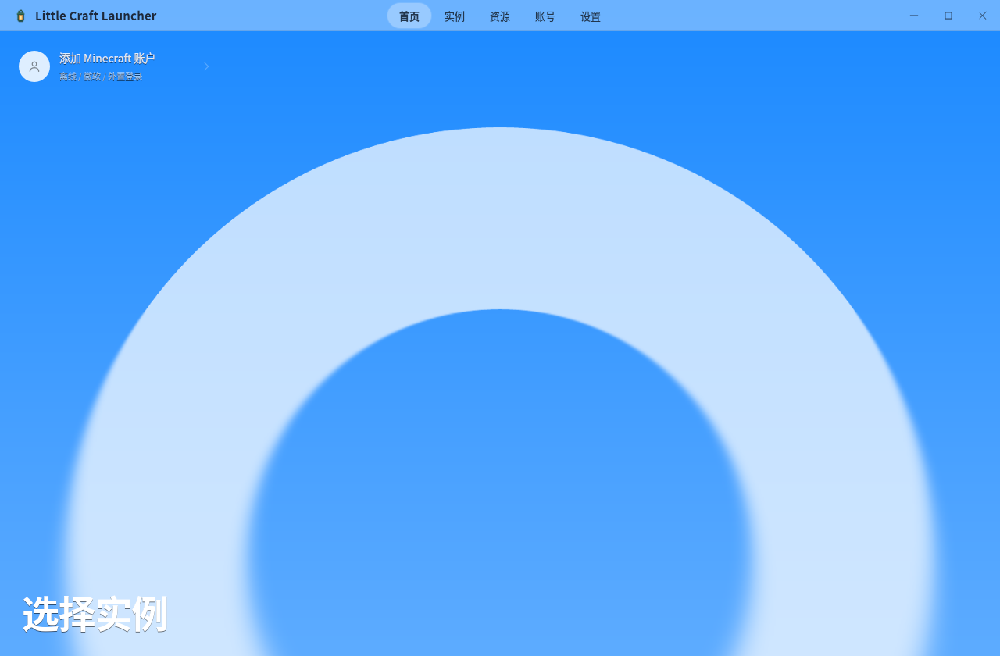
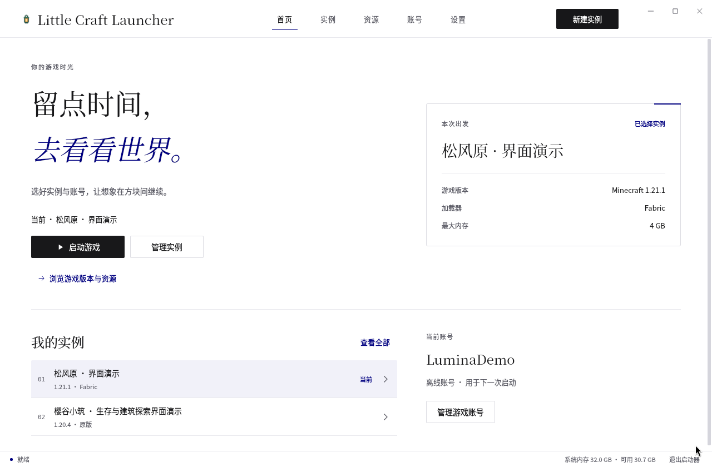

# Little Craft Launcher

**Your worlds, your mods, your next adventure — kept in order.**

A native Minecraft Java Edition launcher for Windows and Linux, with separate instances for each way you play.

**English** · [简体中文](README.zh-CN.md)

[Downloads and release notes](https://github.com/TaoXiaoBai/little-craft-launcher-releases/releases) · [Accounts and data](#accounts-and-data) · [Report an issue](https://github.com/TaoXiaoBai/little-craft-launcher-releases/issues)

Windows 10/11 x64 · Linux x86_64 · Twelve themes + one experimental theme · Qt 6.8 / C++20 / QML

> [!NOTE]
> **1.0.0 is in prerelease testing.** Get available builds from [Releases](https://github.com/TaoXiaoBai/little-craft-launcher-releases/releases). Each version's notes list its changes, requirements and SHA-256 checksums. There is no stable release yet.

## Try the prerelease

| Platform | Download | Start |
| --- | --- | --- |
| Windows 10/11 x64 | Windows ZIP | Extract and run the single `mclauncher-qt.exe`; its runtime is embedded. |
| Linux x86_64 · Ubuntu 22.04+ | Linux AppImage | Make the file executable, then run it on X11/XWayland or Wayland. |

1. **Download and verify.** Choose the package for your platform from [Releases](https://github.com/TaoXiaoBai/little-craft-launcher-releases/releases), then check its SHA-256. [Windows packaging (简体中文)](docs/WINDOWS_DISTRIBUTION.md)
2. **Add an account and choose Java.** Use a compatible Java installation already on your computer, or download a managed runtime in the launcher. See [Accounts and data](#accounts-and-data) for account availability.
3. **Create or import an instance.** Choose a game version and loader, wait for the files to finish downloading, then launch from Home. Back up your worlds before changing versions or modpacks.

Minecraft, Java and account credentials are not bundled.

### Linux AppImage

Without FUSE, use `./LittleCraftLauncher-<version>-linux-x86_64.AppImage --appimage-extract`, then run `./squashfs-root/AppRun`. Qt is bundled; graphics drivers and desktop services come from the system.

Linux supports game launch and downloads of the official Java 8/17/21/25 runtimes. You can also select a locally installed Java that matches the game version. Saving online credentials requires an available system keyring; see [Accounts and data](#accounts-and-data).

## What it does

| What you need | What the launcher provides |
| --- | --- |
| Separate setups | Create, copy and import instances, each with its own game version, Java, memory, launch arguments and server address. Export a modpack when you want to share one. |
| Compatible content | Browse mods, resource packs and modpacks; review dependencies, changes and the target instance before installing. |
| Favourite mods, reused | Save Modrinth projects and find compatible versions for another instance, instead of copying old JARs. |
| Worlds you can return to | Back up and export worlds, and preview an import or restore before applying it. |
| Files around your worlds | Manage screenshots and schematics, and inspect or edit NBT data. Back up files before editing them. |
| Playing together | Create or join a room through the Terracotta integration, with your consent before downloading its component. Multi-device testing is still in progress. |
| Useful feedback | Inspect tasks, logs and diagnostics, and review memory risks before launching. A memory advisory is not a compatibility or FPS verdict. |
| Updates and language | Check for updates under About and open the release page. Choose Simplified Chinese, English or automatic language selection; some diagnostics and experimental text remain Chinese. |

Current scope:

- **Loaders**: Vanilla, Fabric and Quilt install directly. Forge discovers compatible versions from Minecraft **1.18** onwards; NeoForge from **1.20.2** onwards, using official catalogues and supported installer formats. Available combinations are shown in the app. Older Forge versions such as 1.12.2 and 1.16.5, and NeoForge 1.20.1, are not supported. Installer format changes can still require adaptation.
- **Modpacks**: Modrinth packs can be previewed and installed as new instances. CurseForge needs an authorized API key for the current session, and its catalogue cannot create a modpack instance directly yet; local pack import works instead.

## Appearance

Choose under **Settings → Appearance** when no game, sign-in or file operation is active. Themes offer different layouts for the same core functions, support reduced motion, and keep the lantern's original colours. You can also choose a local image as the window background. New installs start on Launchpad; existing data keeps its theme.

| Theme | What it looks like |
| --- | --- |
| **Launchpad** (`启动台`, default) | A narrow icon rail; Home opens with a "continue playing" card that holds the launch button, the instance switcher and anything blocking launch. Eight accent presets or any colour, in light, dark or system mode. |
| **Windows 11** | Rebuilt to Fluent: a Mica-style shell, a rounded content layer, Fluent controls, and Windows-style settings groups (the header on the page, the settings on a card). |
| **Material 3**, **Material 3 Expressive** | A navigation rail with a FAB; M3 switches, sliders, progress bars and tabs; Settings laid out as list sections. |
| **WinUI × MD3** | WinUI's structure with MD3's components and colours. |
| **Koring Glass** (`Koring · 轻玻璃`) | Koring's original wallpaper and centred top navigation; the launch capsule appears when you hover near the bottom of Home. |
| **Lumina** (`留白 · Lumina`) | Generous white space, serif headings and a quiet horizontal navigation; small windows switch to a scrolling column. |
| Legacy | Forest Light, Classic Dark, Graphite, Ore and Sand, folded away by default in the appearance settings. |

| Windows 11 | Material 3 |
| --- | --- |
|  |  |
| **Koring Glass** | **Lumina** |
|  |  |

Screenshots show Qt development windows on Linux with demonstration data. Appearance can vary by platform and version. [Screenshot provenance and artwork credits](assets/README.md).

## Accounts and data

### Microsoft sign-in

Microsoft sign-in opens your system browser and uses official Microsoft, Xbox and Minecraft services to validate the session, Minecraft Java Edition ownership and player profile. The launcher does not ask you to enter your Microsoft password into its own interface. Saved online credentials on Windows use DPAPI protection, without a plaintext fallback.

**Testing status:** The distributed builds include this project's Microsoft client configuration. Use an account that owns Minecraft Java Edition; real-account release acceptance and Mojang service access still need confirmation.

### Account availability

| Region detection | Available accounts |
| --- | --- |
| Mainland China (`CN`, while the result is still valid) | Microsoft; LittleSkin or another external authentication service you explicitly trust; a local offline identity |
| Any other country or region (including `HK`, `MO` and `TW`) | Official Microsoft accounts only, with Minecraft ownership verified |
| Not yet detected, detecting, failed or expired | Official Microsoft accounts only, with Minecraft ownership verified |

LittleSkin is an address suggestion, not automatic trust. External authentication sends that service's credentials only after the user explicitly trusts the selected service. **Do not enter a Microsoft password into an external-authentication form.** External or local identities do not establish Minecraft ownership or grant access to official online services.

### Linux system keyring

Linux saves online credentials through the desktop's Secret Service keyring, such as GNOME Keyring or KeePassXC with Secret Service integration enabled. A working desktop session and an available, unlockable keyring are required. The launcher does not include a keyring daemon. A missing service, failed unlock, cancellation or timeout stops the operation with an error; credentials are not saved as plaintext instead.

### Local data

- For new installs, data defaults to `mclauncher-qt-data` beside the program when the program's directory accepts files; otherwise it falls back to per-user local application data.
- An existing `mclauncher-qt-data` beside the program stays in use. If none exists, existing per-user data stays in use instead of switching to a new program-side directory. Explicit options below override this automatic selection.
- `--portable` uses the directory beside the Windows EXE or Linux AppImage. AppImage portable data stays beside the downloaded file, outside its temporary mount. `--data-root` sets an absolute path and takes precedence.
- Data never moves between locations on its own. Close the game and launcher before backing up or moving the whole directory.

## Feedback and project information

Maintained by [TaoXiaoBai](https://github.com/TaoXiaoBai). This repository is the public home for project information, releases and [issue reports](https://github.com/TaoXiaoBai/little-craft-launcher-releases/issues).

Launcher QQ community: **827507229**.

When reporting a problem, include the launcher version, operating system, reproduction steps, expected and actual behavior, and only the relevant redacted logs. Review logs before sharing them. Keep passwords, access tokens, account databases and private worlds out of public reports.

## Source and licensing

The application source is currently private. Opening the source will be evaluated after the launcher stabilizes; no date has been set. This public repository does not grant a general open-source or unrestricted application-redistribution license.

Third-party components and artwork retain their own licenses. Applicable notices, license texts and version-matched dependency sources or relinking materials are provided with each preview or stable release through its release notes. Keeping application development private does not remove those obligations.

This project is an independent third-party launcher, not an official Mojang or Microsoft product, and is not affiliated with external authentication providers.
