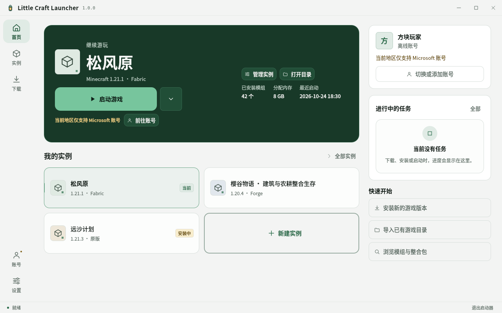
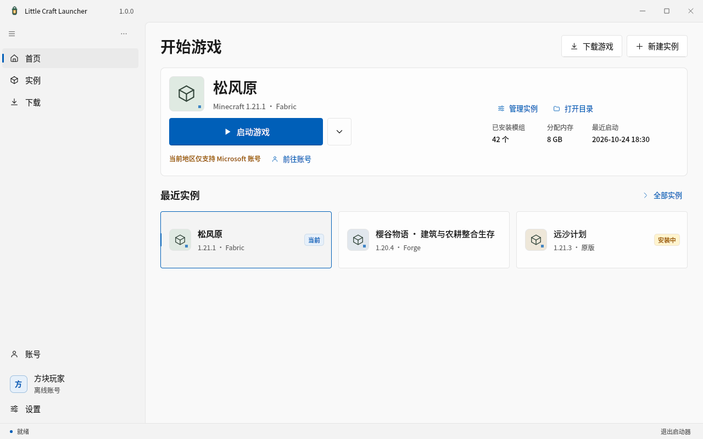
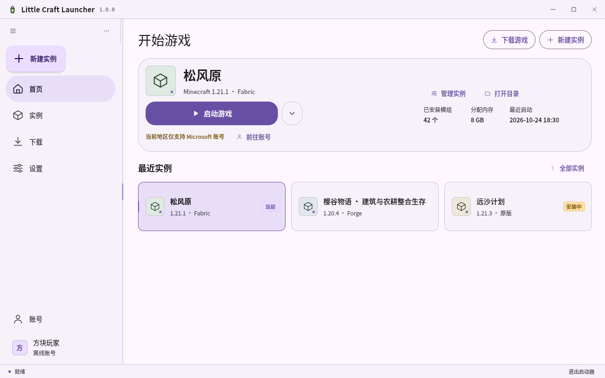
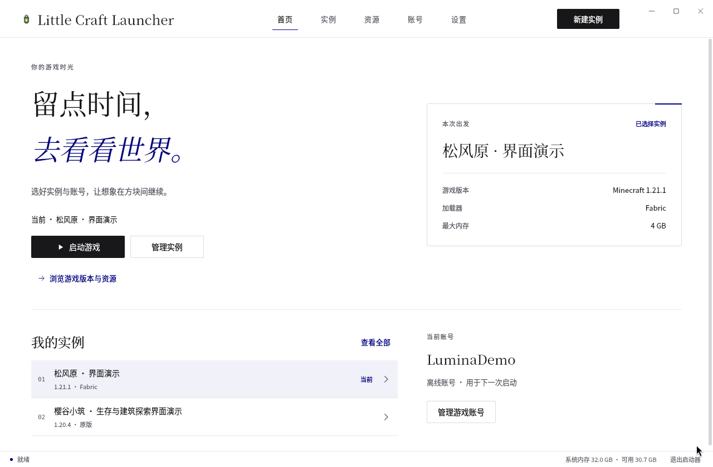

# Little Craft Launcher

**把时间留给方块，把版本、模组和存档交给启动器。**

面向 Windows 和 Linux 的 Minecraft Java 版原生启动器。一个实例，一套配置，让不同玩法各有归处。

[English](README.md) · **简体中文**

[版本下载与更新说明](https://github.com/TaoXiaoBai/little-craft-launcher-releases/releases) · [账号与数据](#账号与数据) · [反馈问题](https://github.com/TaoXiaoBai/little-craft-launcher-releases/issues)

Windows 10/11 x64 · Linux x86_64 · 十二套主题 + 一套测试主题 · Qt 6.8 / C++20 / QML

> [!NOTE]
> **1.0.0 现处于预发布测试阶段，尚无正式版。** pre.5 更新补齐 Linux 游戏启动、Java 管理和系统密钥环凭据保存，Linux 提供单个 AppImage，Windows 提供 ZIP。请从 [Releases](https://github.com/TaoXiaoBai/little-craft-launcher-releases/releases) 下载可用版本，并阅读对应的安装说明与账号要求。
>
> 预览界面使用简体中文。截图来自开发窗口，不是已发布的 Windows 版本。

## 试用预发布版本

1. **下载并校验。** 从 [Releases](https://github.com/TaoXiaoBai/little-craft-launcher-releases/releases) 下载，阅读发行说明并核对 SHA-256。当前 Windows ZIP 需完整解压后运行 `mclauncher-qt.exe`，请保留相邻的 DLL 与运行库目录。
2. **添加账号，选择 Java。** 可用的账号类型取决于地区，见下文[账号与数据](#账号与数据)。
3. **创建或导入实例。** 选择游戏版本和加载器，等游戏文件准备好后从首页启动。更换版本或整合包前，请先备份存档。

启动器不附带 Minecraft、Java 或账号凭据。

### Linux AppImage

pre.5 AppImage 面向 Ubuntu 22.04 或更新版本的 x86_64 系统，支持 X11/XWayland 和 Wayland。下载后赋予执行权限即可运行。没有 FUSE 时，可执行 `./LittleCraftLauncher-<版本>-linux-x86_64.AppImage --appimage-extract`，再运行 `./squashfs-root/AppRun`。包内附带 Qt，显卡驱动和桌面服务由系统提供。

Linux 支持游戏启动，以及官方运行时 Java 8/17/21/25 的下载管理，也可选择与游戏版本匹配的本机 Java。在线凭据保存需要可用的系统密钥环，见下文[账号与数据](#账号与数据)。

旧版 [v1.0.0-pre.4](https://github.com/TaoXiaoBai/little-craft-launcher-releases/releases/tag/v1.0.0-pre.4) 仍为界面预览，不含这些 Linux 功能。其 TAR 包需要完整解压并通过 `LittleCraftLauncher` 启动；直接运行内部 ELF 可能绕过运行库配置。已有 pre.4 下载保持不变。

## 能帮你做什么

| 你想做的事 | 启动器如何帮忙 |
| --- | --- |
| 把不同周目分开 | 创建、复制和导入实例，分别设置游戏版本、Java、内存和启动参数；需要分享时可导出整合包。 |
| 装上合适的内容 | 浏览模组、资源包和整合包，确认目标实例，预览依赖与变更后再安装。 |
| 下个版本接着用常用模组 | 收藏 Modrinth 项目，为新实例重新寻找兼容版本，不必照搬旧 JAR。 |
| 给存档留条退路 | 备份、导出世界，导入或恢复前先查看预览。 |
| 看懂运行状态 | 查看任务、日志和诊断，启动前检查内存风险。内存提示不代表帧率或完整兼容性结论。 |

当前范围：

- **加载器**：原版、Fabric、Quilt 可以直接安装；原生 Forge 安装器目前只面向 Minecraft **1.20.1**，NeoForge 只面向 **1.21.1**。其他组合以界面中可选的为准，不作兼容承诺。
- **整合包**：Modrinth 整合包可以在线预览并安装为新实例。CurseForge 需要仅限本次会话的授权 API key，目录中暂不能直接新建整合包实例，可以改用本地导入。

## 外观

十二套主题共用同一套页面和控件，都支持减少动态效果。在没有游戏、登录或文件操作进行时，可到**设置 → 外观**中切换；灯笼图标始终保持原色。新安装默认使用启动台，已有数据保留原来的主题。

| 主题 | 特点 |
| --- | --- |
| **启动台**（默认） | 左侧窄图标栏；首页最上方的“继续游玩”大卡片集中了启动按钮、实例切换和启动阻碍。可选 8 种预设强调色或任意颜色，以及亮色、深色、跟随系统。 |
| **Windows 11** | 按 Fluent 规范重做：Mica 风格外壳、圆角内容层、Fluent 控件，设置页“标题在页面上、设置项在卡片里”。 |
| **Material 3**、**Material 3 Expressive** | 带 FAB 的导航栏，M3 开关、滑块、进度条和选项卡，设置页按列表分区。 |
| **WinUI × MD3** | 取 WinUI 的结构，用 MD3 的组件和配色。 |
| **Koring · 轻玻璃** | Koring 原作壁纸、顶部居中胶囊导航；鼠标移到首页底部时显出启动胶囊。 |
| **留白 · Lumina** | 大留白、衬线标题、克制的横向导航，小窗口中自动改为纵向滚动。 |
| 旧主题 | 林影亮色、经典深色、石墨、矿物、岩沙，在外观设置中默认折叠。 |

| Windows 11 | Material 3 |
| --- | --- |
|  |  |
| **Koring · 轻玻璃** | **留白 · Lumina** |
|  |  |

以上为真实 Qt 开发窗口，在 Linux 下以软件渲染采集，使用演示数据，不代表 Windows 验收、真实账号登录、游戏运行或帧率结论。[截图来源与素材许可](assets/README.md)。

## 账号与数据

### Microsoft 登录

Microsoft 登录实现通过系统浏览器打开授权页面，采用 OAuth 授权码、S256 PKCE 和本机回调，再通过 Microsoft、Xbox 与 Minecraft 官方服务验证会话、Minecraft Java 版拥有权和角色资料。启动器不会要求用户在其自身界面输入 Microsoft 账号密码。Windows 上保存的 Microsoft 登录凭据使用 DPAPI 加密，不提供明文回退。

**当前状态：**本项目自己的公共客户端配置与相关服务准入仍在准备，真实 Microsoft 账号登录的发行验收尚未完成。应用注册、服务准入与用户授权是分别需要完成的事项；登录配置须使用本项目自有或获明确授权的公共 Client ID。

### 账号可用范围

| 地区检测结果 | 可用账号 |
| --- | --- |
| 中国大陆（`CN`，且检测结果仍有效） | Microsoft；LittleSkin 或你明确信任的其他外置认证服务；本机离线身份 |
| 其他国家和地区（含 `HK`、`MO`、`TW`） | 仅 Microsoft 官方账号，并验证 Minecraft 拥有权 |
| 未检测、检测中、检测失败或已过期 | 仅 Microsoft 官方账号，并验证 Minecraft 拥有权 |

未配置 Microsoft 登录时，该登录方式不可用，在只能使用 Microsoft 的地区也就无法添加账号。

LittleSkin 只是地址建议，不代表自动信任。外置认证仅在用户明确信任所选服务后，向该服务发送其凭据。**不要把 Microsoft 密码填入外置认证表单。** 外置或本机身份不代表 Minecraft 正版拥有权，也不授予官方在线服务访问权。

### Linux 系统密钥环

Linux 通过桌面的 Secret Service 密钥环保存在线凭据，例如 GNOME Keyring，或开启 Secret Service 集成的 KeePassXC。需要正常运行的桌面会话和可用、可解锁的密钥环；启动器不内置密钥环守护进程。服务缺失、解锁失败、取消或超时都会停止操作并提示错误，不会改存明文凭据。

### 本地数据

- 新安装使用每用户本地应用数据目录；程序旁已有的 `mclauncher-qt-data` 会继续沿用。
- `--portable` 使用 Windows EXE 或 Linux AppImage 旁的便携目录；AppImage 的便携数据保存在下载文件旁，不写入临时挂载目录。`--data-root` 指定一个绝对路径，优先级最高。
- 数据不会在目录之间自动迁移。备份或移动整个数据目录前，请先关闭游戏和启动器。

## 项目信息与反馈

项目由 [TaoXiaoBai](https://github.com/TaoXiaoBai) 维护。本仓库是公开的项目介绍、版本发布和[问题反馈](https://github.com/TaoXiaoBai/little-craft-launcher-releases/issues)入口。

启动器 QQ 交流群：**827507229**。

反馈时请附启动器版本、操作系统、复现步骤、预期与实际行为，以及相关的脱敏日志。分享前请自行检查日志；不要公开密码、访问令牌、账号库或私人存档。

## 源码与许可

应用源码暂未公开，待启动器稳定后再评估开源安排，时间尚未确定。本公开仓库不授予应用的一般性开源或任意再分发许可。

第三方组件与素材继续遵循各自的许可。适用的通知、许可文本及与版本匹配的依赖源码或可重链接材料，随预发布及正式版本提供，并在发布说明中给出获取入口。应用开发保持私有，不免除这些交付义务。

本项目是独立的第三方启动器，并非 Mojang 或 Microsoft 官方产品，亦不与外置认证服务运营方存在隶属关系。
